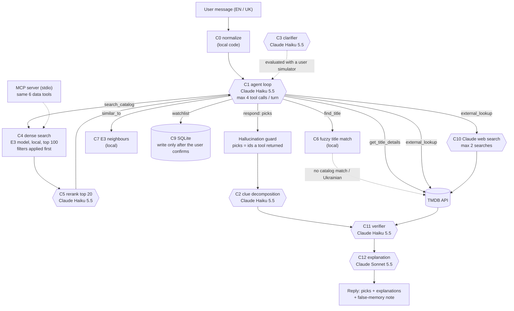

# Emberfall Movie Detective

A Claude tool-use agent for tip-of-the-tongue film search (English and Ukrainian), built on
top of the Emberfall iOS app's search as the baseline. UCU NLP, Assignment 1.

- Presentation notebook (CRISP-DM): `notebooks/Emberfall_Detective.ipynb`
- Report: `docs/REPORT.md`; scope and decisions: `docs/PROJECT_BRIEF.md`
- How the coding agent was run: `AGENTS.md`, `.claude/skills/`, `WORKING_STATE.md`, `DEV_LOG.md`

## Data flow



Legend: hexagons are Claude model calls, cylinders are external services or storage,
rectangles are local code / local models (E3 runs on the machine).

## Layout

| Path | What |
|---|---|
| `concierge/agent.py` | the agent loop (Haiku 5.5, 7 tools, rules enforced in code) |
| `concierge/tools/` | the tools; `registry.py` is the single source of names and schemas |
| `concierge/retrieval/` | dense retrieval (E3) and the Haiku reranker |
| `concierge/{clues,clarify,verify,explain,normalize}.py` | C2, C3, C11, C12, C0 |
| `concierge/mcp_server.py` | the data tools over MCP (stdio) |
| `data/` | catalog export / extension / EDA and gold-set builders |
| `evals/` | one module per component, `run.py` (runner), `gold/`, `results/`, `baseline/` |

## Run

```
uv sync --all-groups
uv run pytest                                   # unit tests, no network
uv run python -m concierge.chat                 # the demo in the terminal, with a live trace
uv run --with gradio python -m concierge.chat --web   # the same in the browser
uv run python -m evals.run --component c4 --config tool_whole   # one eval (dev split)
claude mcp add emberfall -- uv --directory "$PWD" run python -m concierge.mcp_server
```

Keys (never exported globally): `EMBERFALL_CLAUDE_KEY`, `TMDB_API_KEY` in `.env` or Colab
Secrets. Large local assets, not in git: `data/catalog_extended.parquet` (built by
`data/export_catalog.py` + `data/extend_catalog.py`), `models/E3` (the fine-tuned retriever),
`.cache/` (LLM and TMDB responses; with it, every eval and the notebook replay without keys).
