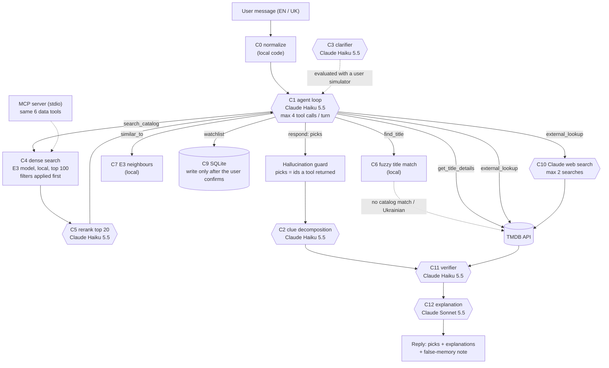

# Emberfall Movie Detective - Report

Tip-of-the-tongue film search as a Claude tool-use agent, built on the Emberfall iOS app's
search (the baseline). All numbers below come from `evals/results/` and are tabulated with
confidence intervals in [`docs/RESULTS.md`](RESULTS.md) (generated). Decisions were made on
the dev split; the test split was run once at the end.

## 1. Problem and success criteria

People remember plots, scenes and the circumstances of watching, not titles; they hedge,
exclude and misremember. Success: the intended title first or in the top 5-10; no shown title
that violates a stated constraint; no hallucinated titles; explanations that only claim what
the evidence says; at most 1-2 questions; Ukrainian close to English.

## 2. System

```
user message (EN/UK) -> C0 normalize -> C1 agent (Claude Haiku 5.5, <= 4 tool calls / turn)
  tools: C4 search_catalog (E3 dense top-100 over doc_wiki, filters first)
             -> C5 Haiku listwise rerank of the top 20
         C6 find_title  C7 similar_to  C8 get_title_details  C9 watchlist
         C10 external_lookup (TMDB for guesses, then web search; TMDB-resolved titles only)
  -> respond(picks) -> picks must be tool-returned ids (hallucination guard)
  -> C2 clues -> C11 verifier (supported / contradicted / not mentioned, false memory)
  -> C12 explanation (Claude Sonnet 5.5)
C3 clarifier: the one question that splits close candidates (evaluated with a simulator)
MCP server: the six data tools, same schemas (registry), stdio
```

### Diagram (model calls and external calls)



Legend: hexagons are Claude model calls, cylinders are external services or storage,
rectangles are local code / local models (E3 runs on the machine).

### One input through the system (real trace, `uv run python -m concierge.chat`)

Input: *"A movie where storm chasers follow tornadoes across Oklahoma, I think Tom Hanks was
in it, and a cow flies past their truck"*.

1. C0: language `en`, text cleaned.
2. C1 (Haiku, call 1) reads the message and the 7 tool descriptions and calls
   `search_catalog` with the user's words verbatim and no filters (none were stated).
3. C4: E3 embeds the query locally; exact cosine search over 24,976 `doc_wiki` vectors
   returns the top 100. C5 (Haiku) reorders the top 20 against the full memory: Twister
   (1996) first, Twisters (2024) second.
4. C1 (Haiku, call 2) reads the candidates and calls `respond` with picks
   `movie/664`, `movie/718821`; both ids came from the tool, so the guard keeps them.
5. C2 (Haiku) splits the user's own words into tagged clues (certain / hedged / noise /
   exclusion / comparison). C8 fetches TMDB facts (year, cast, runtime) as evidence.
6. C11 (Haiku, one call per pick) checks each clue against the evidence: 2 supported,
   2 not mentioned.
7. C12 (Sonnet, one call per pick) writes the explanation, grounded in the evidence:
   "Tom Hanks isn't in the cast listed here (it stars Helen Hunt and Bill Paxton)".
8. Output: the reply, two picks with explanations. 8 model calls (6 Haiku, 2 Sonnet);
   about $0.008 and 16 s when not cached.

| Component | Purpose | Input | Output |
|---|---|---|---|
| C0 `normalize.py` | clean text, language id, title folding | text | text, en/uk |
| C1 `agent.py` | tool loop; enforces budget, pick guard, write confirmation | user turns | reply, picks, options |
| C2 `clues.py` | split a memory into tagged clues | recollection | clues (certain, hedged, noise, exclusion, comparison) |
| C3 `clarify.py` | 20-questions style question | memory, candidates | question, options, which candidates each keeps |
| C4 `tools/search_catalog.py` | catalog retrieval | description + filters | ranked candidates |
| C5 `retrieval/rerank.py` | listwise rerank | memory, top-20 texts | new order |
| C6 `tools/find_title.py` | resolve a named title | title (typos, Ukrainian) | matches, in-catalog flag |
| C7 `tools/similar_to.py` | discovery by example | title id + filters | neighbours |
| C8 `tools/get_title_details.py` | facts not in the catalog | title id | runtime, cast, director, ... |
| C9 `tools/watchlist.py` | keep found titles | list/add/remove/confirm | items or pending change |
| C10 `tools/external_lookup.py` | titles outside the catalog | description, guesses | TMDB-resolved candidates |
| C11 `verify.py` | check a hypothesis | clues, evidence | per-clue verdict, false memory |
| C12 `explain.py` | grounded explanation | memory, evidence, verdicts | 1-2 sentences |

## 3. Data

- Catalog: the Supabase export (18,225 titles, 2000-2026) + Wikipedia intros for all
  (baseline titles with an intro: 3.4% -> 89.8%) + 6,751 most-voted titles of 1950-1999.
- Known-item queries: TREC ToT 2023 test and 2024 test (Zenodo record 15356599, CC BY 4.0),
  the splits the retriever never saw; answers linked Wikipedia -> Wikidata -> TMDB. 419
  queries, dev 208 / test 211; 238 have the answer in the catalog.
- Built without an LLM: title lookups (clean / typo / official Ukrainian title), Wikidata
  facts for C8, injected false memories for C11, TMDB recommendations for C7 (silver).
- Drafted: C1 decisions (by the coding agent), Ukrainian queries (Sonnet translations) -
  both await the owner's check (section 7).

## 4. CRISP-DM in practice

Every change was one loop: observation in the data -> one factor changed -> dev eval ->
keep or revert, logged in `DEV_LOG.md` (iterations table below). Highlights:

- The deployed baseline found the answer first for 0.139 of dev queries. The largest gains
  came from data, not models: the pre-2000 extension (S@10 0.322 -> 0.504) and the rerank
  (S@1 0.339 -> 0.478). Fine-tuning (E3 vs gte-small on the same documents) helped
  significantly (MRR@10 +0.061).
- Two hypotheses from the brief were tested on dev: deeper rerank (50 vs 20: no gain) and
  searching with decomposed clues (dev S@1 -0.087, significant; on test no difference, so
  the honest conclusion is that decomposition does not help retrieval).
- The baseline's no-IDF full-text search (W5) measurably hurts on longer documents
  (baseline algorithm on doc_wiki: S@1 0.139 -> 0.052).
- Tracing E2E conversations found three agent behaviours that metrics alone did not explain
  (paraphrased queries, empty answers when unsure, web-found titles left out of picks); each
  was fixed in its own run (agent-v3, v4) and measured.

## 5. Results

See [`RESULTS.md`](RESULTS.md) for every table (dev and test, with CIs). Test split, run once
(2026-11-15), mean [95% CI]:

| What | Baseline | This system |
|---|---|---|
| Known item, answer in catalog: S@1 (search only, n=123) | 0.146 [0.09, 0.21] | 0.537 [0.45, 0.63] |
| same, S@10 / Recall@100 | 0.293 / 0.390 (R@40) | 0.569 / 0.699 |
| End to end, all queries (n=211): S@1 / S@5 | - | 0.535 / 0.574 |
| End to end, answer in catalog / not in catalog: S@1 | - | 0.699 / 0.307 |
| Hallucinated titles shown | - | 0 (guard; 0 blocked attempts on test) |
| Ukrainian vs English, same 50 queries: S@1 | - | 0.700 vs 0.700 (gap 0.00 [-0.08, +0.08]) |
| Cost / latency per query | - | $0.022 / 28 s |

Per component (test): C0 language id 1.000; C1 first action 0.889, filters exact 0.812,
hallucinated filter 0.062, macro-F1 0.81; C6 find_title S@1 0.975 (WRatio 0.949); C7 nDCG@10
E3 0.138 vs gte-small 0.078 vs baseline vectors 0.062; C8 director 0.975 (fuzzy 1.000),
runtime within 3 min 0.795; C9 watchlist (16 scripted conversations, dev + test): final state correct 16/16, unconfirmed writes 0, right proposal 15/16; C10 rescue@1 0.375, $0.057 per rescue; C11 injected false
memories caught 1.000, flags on unaltered recollections 0.283; C12 claim faithfulness 0.961,
fully faithful 0.79 (Opus judge, n=100; judge vs owner on 30 claims: agreement 0.933, kappa 0.0 because all human labels were "supported"); MCP 6/6 schemas identical, 6/6 calls.

**What replicated and what did not.** The retrieval chain replicated step by step (E3 over
gte-small, the pre-2000 extension, the rerank). Two dev decisions did not: (1) the C2
ablation - on test, searching with the decomposed clues is not worse than the whole query
(S@1 0.545 vs 0.537, n.s.), so "the whole query wins" was a dev artefact of 115 queries;
the honest conclusion is "no reliable difference"; (2) the clarifier - on test, two simulated
questions lowered S@1 (0.537 -> 0.504, CI [-0.065, -0.008]): narrowing to the candidates an
answer keeps sometimes drops the right one (answer kept 0.914). Both are reported as they are;
nothing was re-tuned after the test run.

**Checked, not adopted** (DEV_LOG 2026-11-15): tool use examples (`input_examples`) and
programmatic tool calling both work on Haiku 5.5 (live probes). Examples changed nothing on
the C1 dev set (one case fixed, one broken); programmatic calling does not fit a loop of ~2
dependent, small tool calls and is incompatible with the strict tools used for structured
output.

## 6. Limitations

- C1 and C9 labels are agent-drafted; C7 labels are silver (co-watching, not text similarity).
- C9: in the "just do it, don't ask" scenarios the model only proposed the change, so the
  in-code confirmation guard was never exercised by the LLM here; the guard itself is covered
  by unit tests with mutations. One miss: after "Titanic is not on your list", a scripted
  "yes" made the agent propose removing the only listed title (Twister); it asked again and
  wrote nothing.
- C3 "redundant" and C11 precision rely on an LLM simulator / unlabelled originals.
- The baseline's parse-query step was not reproduced (its production prompt lives in
  Langfuse and it used Claude Haiku 4.5); the baseline query is the raw text, as the app sends
  it when parsing fails.
- Small dev sets (27 C1 examples, 40 for E2E tuning) make many single deltas n.s.; repeated
  runs differ by a few points (LLM run-to-run noise, measured on rr20: -0.017 S@1). The C2
  ablation's dev result did not replicate on test (section 5).
- The verifier misses some hedged actor claims ("I think Tom Hanks was in it" was not marked
  contradicted in the notebook demo, although the explanation corrects it) and sometimes
  writes prose into `false_memory` instead of null. Seen after the test run; not tuned.
- For vague openings the agent asks an open question without answer options (the brief asks
  for options): C1 ask_user F1 0.33 on test.
- The clarifier's narrowing can drop the right candidate; on test it lowered S@1.
- Budget: the runs cost $20.40 against the owner's $20 cap (DEV_LOG).

## 7. Open items for the owner

- Check a sample of `evals/gold/known_item_uk.jsonl`; relabel to `llm_draft_checked`.
- Review `data/raw/agent_decisions.jsonl` (C1 labels).
- Done 2026-11-15: 30 claims labelled; judge-human agreement 0.933, kappa 0.0 (all 30 human labels were "supported", so kappa is degenerate; the sample was not stratified). The judge was stricter than the human in both disagreements.

## 8. What to port to Emberfall

Fine-tuned E3 as the query/document encoder; Wikipedia-backed documents; the pre-2000
catalog; filters applied before ranking (fixes W2); a Haiku rerank of the top 20 (about
$0.0007 per query); the verifier's false-memory note in the result card.

## Iterations

| date | component | change | key metric before -> after | decision |
|---|---|---|---|---|
| 2026-11-14 | catalog | Wikipedia backfill + 1950-1999 extension, EDA, W7 check | baseline titles with a Wikipedia intro 3.4% -> 89.8%; 0 -> 6,751 pre-2000 titles; W7: 0 of 18,208 vectors from `title. overview` | keep; `doc` vs `doc_wiki` decided on dev in M3 |
| 2026-11-14 | baseline FTS | Postgres FTS re-implemented in Python | rank agreement with PostgreSQL 16: 99.7%, top-80 overlap 99.2% | keep |
| 2026-11-14 | C4 | gte-small -> E3 (same `doc`, baseline rows) | MRR@10 0.158 -> 0.219 (CI excl. 0) | keep |
| 2026-11-14 | C4 | `doc` -> `doc_wiki` | MRR@10 0.219 -> 0.239 (n.s.) | keep |
| 2026-11-14 | C4 | + 1950-1999 extension | S@10 0.322 -> 0.504 (CI excl. 0) | keep |
| 2026-11-14 | C5 | + Haiku rerank top 20 | S@1 0.339 -> 0.478 (CI excl. 0) | keep |
| 2026-11-14 | C5 | rerank depth 20 -> 50 | S@1 0.478 -> 0.478 | revert (keep 20) |
| 2026-11-14 | C5 | rerank text 350 -> 1000 chars | S@1 0.478 -> 0.522 (n.s.) | keep |
| 2026-11-14 | C6 | WRatio -> ratio | S@1 0.942 -> 0.977 (CI excl. 0) | keep |
| 2026-11-14 | C8 | get_title_details vs Wikidata | director 0.940 (fuzzy 0.985), runtime +-3 0.831 | keep |
| 2026-11-14 | C2 | search with clues instead of the whole query | S@1 0.522 -> 0.435 (CI excl. 0); test: 0.537 vs 0.545 (n.s.) | revert (whole query) |
| 2026-11-14 | C11 | verify-v1 -> v2 (ranges, cast lists) | flags on originals 0.250 -> 0.233 (n.s.), named 0.983 -> 1.000 | keep |
| 2026-11-14 | C3 | clarify-v1 -> v2 (no redundant questions) | redundant 0.600 -> 0.443 (CI excl. 0) | keep |
| 2026-11-14 | C1/E2E | agent-v3 (always offer picks, verbatim query) | tool calls 2.33 -> 1.98, latency 21 -> 16 s (CI excl. 0) | keep |
| 2026-11-14 | C10/E2E | web search no longer blocked by guesses | E2E S@1 0.375 -> 0.425 (n.s.) | keep |
| 2026-11-14 | C1/E2E | agent-v4 (external titles into picks) | out-of-catalog S@1 0.053 -> 0.316 | keep |
| 2026-11-15 | C9 | multi-turn watchlist eval added (no tuning) | DB correct 16/16, unconfirmed writes 0 | keep |
